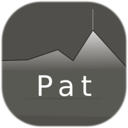
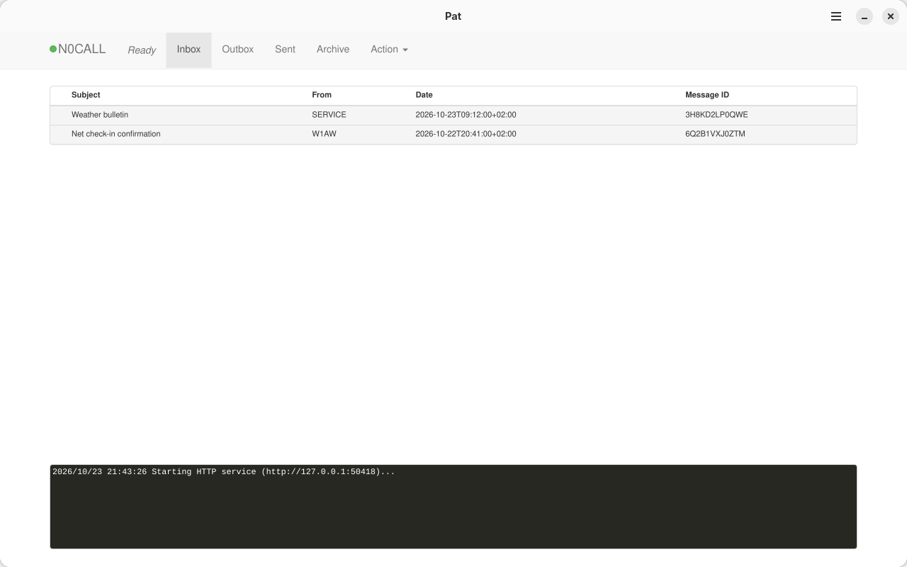

<div align="center">
  
  <h1>Pat Desktop</h1>
  <p><strong>Pat, the Winlink client, as a regular desktop app.</strong><br>
  With free modems built in: ARDOP, VARA-compatible HF and FM, Mercury and packet. For the Linux desktop, x86_64 and ARM.</p>
  <p>
    <a href="https://code.alvaroedo.io/alvaroemtnez/pat-desktop/releases"></a>
  </p>
  <br>
</div>

> [!IMPORTANT]
> Pat Desktop is an **unofficial**, community-maintained project. It is **not affiliated with, endorsed by or supported by** the [Pat project](https://getpat.io), its author Martin Hebnes Pedersen (LA5NTA), or the Winlink Development Team. Please report problems with Pat Desktop here, not upstream, unless you can reproduce them with the plain `pat` command.

[Pat](https://github.com/la5nta/pat) is an excellent cross-platform Winlink client. On Linux you normally install it with Go or a package, start it from a terminal (`pat http`) and use it from a browser at `http://localhost:8080`. Pat Desktop does that for you: it starts from your application menu, opens in its own window, and starts and stops Pat in the background.



## Features

- **A real desktop app.** Launcher icon, its own window, single instance, keyboard shortcuts, desktop notifications for new messages.
- **No ports, no terminal.** Pat runs as a managed child process on a private loopback port. Closing the window shuts Pat down cleanly, and asks first if a Winlink session is in progress.
- **Radio setup from the app.** Your first launch opens Pat's configuration page (callsign, locator, ARDOP, VARA, PACTOR, AX.25, Hamlib rig control, GPSd, …). It is always under *Menu → Pat Configuration* (<kbd>Ctrl</kbd>+<kbd>,</kbd>).
- **Forms, attachments and links behave like a desktop app.** Winlink forms open in their own windows, attachments are saved through the normal file dialog, and external links open in your browser.
- **Light and dark.** Follows your desktop's light/dark setting. In dark mode Pat's pages use GNOME's dark colours.
- **Free modems built in.** ardopcf (ARDOP), xara (VARA-compatible HF and FM), Mercury, Direwolf (packet) and Hamlib's rigctld come with the app. Turn on the ones you need in *Menu → Modems*; they start and stop with Pat. See [Modems](#modems).
- **Troubleshooting built in.** *Menu → Show Log* gives a live view of the output of Pat and the modems, and *Restart Pat* restarts it without restarting the app.
- **Pristine upstream Pat.** Pat is built unmodified from a pinned upstream release tag, the same code as the official binaries, and identifies itself to Winlink exactly as upstream Pat does.

## Installing

Download from the [releases page](https://code.alvaroedo.io/alvaroemtnez/pat-desktop/releases) (also on the [GitHub mirror](https://github.com/alvaroemtnez/pat-desktop/releases)). Each release has a Flatpak bundle and an AppImage for `x86_64` (most PCs) and `aarch64` (64-bit ARM: Raspberry Pi 4 and 5 with a 64-bit OS, ARM laptops), and a `SHA256SUMS` file with its signature, `SHA256SUMS.asc`. To check a download (more in [docs/verifying.md](docs/verifying.md)):

```sh
gpg --verify SHA256SUMS.asc SHA256SUMS
sha256sum -c --ignore-missing SHA256SUMS
```

### Flatpak (recommended)

```sh
flatpak install --user Pat_Desktop-X.Y.Z-x86_64.flatpak     # or -aarch64
```

The GNOME runtime it needs is fetched from Flathub automatically. The Flatpak is recommended because:

- it includes everything it needs, the same tested libraries on every distribution;
- it runs sandboxed, with access to the network, sound and serial devices but not your files;
- it works on any distribution with Flatpak, including immutable ones like Fedora Silverblue or SteamOS.

To update, install the newer bundle the same way. Your configuration and mailbox are kept.

### AppImage

The AppImage bundles Pat and the modems but **uses GTK 4, libadwaita and WebKitGTK from your system** (and its sound, USB and udev libraries, which every desktop has). That keeps it small, but it needs a fairly recent distribution, e.g. Ubuntu 24.04+, Debian 13+ or Fedora 40+, with these packages installed:

| Distribution | Command |
|---|---|
| Debian, Ubuntu | `sudo apt install python3-gi gir1.2-gtk-4.0 gir1.2-adw-1 gir1.2-webkit-6.0 gir1.2-soup-3.0` |
| Fedora | `sudo dnf install python3-gobject gtk4 libadwaita webkitgtk6.0 libsoup3` |
| Arch | `sudo pacman -S python-gobject gtk4 libadwaita webkitgtk-6.0 libsoup3` |

Then:

```sh
chmod +x Pat_Desktop-X.Y.Z-x86_64.AppImage
./Pat_Desktop-X.Y.Z-x86_64.AppImage
```

If something is missing, the AppImage tells you which packages to install. It is not sandboxed and uses the same files as a native Pat install (`~/.config/pat`, `~/.local/share/pat`), so you can switch between them. Just don't run both at the same time. To get a menu entry, use an AppImage integration tool such as [Gear Lever](https://flathub.org/apps/it.mijorus.gearlever) or AppImageLauncher.

The AppImage carries update information: Gear Lever and AppImageUpdate update it from the latest release, downloading only the parts that changed (a `.zsync` file sits beside each AppImage in the release). Betas are not offered as updates.

### Radio hardware and permissions

| What | Flatpak | AppImage |
|---|---|---|
| Telnet / CMS, ARDOP, VARA, rigctld, AGWPE/Direwolf, GPSd (all over TCP) | Works | Works |
| Sound cards for the bundled modems | Works | Works |
| Serial and USB devices (PACTOR modems, KISS TNCs, CAT/PTT cables) | Works. Your user still needs access to the device, usually through the `dialout` group | Same |
| CM108 PTT (`/dev/hidraw*`) | Works if your user can open the device (a udev rule, as for any program) | Same |
| Linux kernel AX.25 (`ax25+linux` engine) | Opt in, so Pat can read `/etc/ax25/axports`: `flatpak override --user --filesystem=host-etc:ro io.getpat.desktopapp` | Works |

Pat talks to modems and rig control through separate programs over TCP. Pat Desktop bundles free ones (next section); others, like VARA under Wine or a modem on another computer, keep working as with plain Pat.

## Modems

Pat connects to its modems over TCP, at the addresses in its configuration: ARDOP, VARA HF, VARA FM, and AGWPE for packet. *Menu → Modems* lets Pat Desktop run a bundled modem for each of them. It listens exactly where Pat's configuration expects that transport, so nothing changes in Pat: the TCP link is still there, inside the app, on `127.0.0.1`.

| Pat transport | Bundled modem | Notes |
|---|---|---|
| ARDOP | [ardopcf](https://github.com/pflarue/ardop) | ARDOP 1, as Winlink gateways run it |
| VARA HF | [xara](https://code.alvaroedo.io/alvaroemtnez/xara) or [Mercury](https://github.com/Rhizomatica/mercury) | xara is a clean-room, VARA-compatible modem, built with every mode. Mercury speaks VARA's TCP protocol but its own waveform: it only connects to other Mercury stations |
| VARA FM | xara | Wide or narrow |
| Packet (AX.25, AGWPE engine) | [Direwolf](https://github.com/wb2osz/direwolf) | 1200 or 9600 bd |
| Rig control | Hamlib's [rigctld](https://github.com/Hamlib/Hamlib) | On `localhost:4532` |

For each one you choose the sound card and how the radio is keyed:

- **Pat or VOX**: the modem leaves PTT alone. Pat keys the radio through rig control (in Pat's configuration: a rig with the address `localhost:4532`, chosen for the transport, with PTT control on), or the radio's VOX does. Pat can't key the radio for packet.
- **Rig control (rigctld)**, **serial RTS or DTR**, or a **CM108** sound card's GPIO: the modem keys the radio itself. Not every modem has every method.

The callsign and addresses come from Pat's configuration; when they change there, the modems restart with them. Use the radio interface's own sound card: xara refuses the system default, so it never transmits into your speakers. The modems' output goes to *Menu → Show Log*.

VARA itself is not included: it is proprietary, with a licence that forbids redistribution. It still works with Pat Desktop like it does with Pat.

### Moving an existing Pat setup into the Flatpak

The Flatpak keeps its own copy of Pat's files. To reuse your current configuration and mailbox, quit Pat Desktop and run:

```sh
mkdir -p ~/.var/app/io.getpat.desktopapp/config ~/.var/app/io.getpat.desktopapp/data
cp -r ~/.config/pat ~/.var/app/io.getpat.desktopapp/config/
cp -r ~/.local/share/pat ~/.var/app/io.getpat.desktopapp/data/
```

Pat's `http_addr` setting is ignored: Pat Desktop always listens on a private loopback address. If you want to reach Pat from other devices on your network, use plain `pat http` instead.

## How it works

```
┌──────────────── Flatpak sandbox / AppImage ─────────────────┐
│  Pat Desktop (Python, GTK 4, libadwaita)                    │
│   ├─ starts:  pat http --addr 127.0.0.1:<port>              │
│   ├─ WebKitGTK window showing Pat's own web UI              │
│   ├─ starts the enabled modems, where Pat expects them      │
│   └─ stops them all on quit                                 │
│  bin/pat ← unmodified upstream Pat, pinned tag and commit   │
│  bin/ardopcf, xara, mercury, direwolf, rigctld ← the same   │
└─────────────────────────────────────────────────────────────┘
```

The wrapper does not change Pat or re-implement its UI. It handles what a browser tab can't do well: process lifecycle, windows for forms, downloads, notifications, external links, and hiding Pat's "download the new version" prompt, which doesn't apply when the app is updated as a whole. [docs/ARCHITECTURE.md](docs/ARCHITECTURE.md) explains why Pat is built in instead of being downloaded at runtime.

## Building

Both scripts write to `dist/`.

**Flatpak.** Needs `flatpak`, plus `flatpak-builder` or `org.flatpak.Builder` from Flathub:

```sh
tools/build-flatpak.sh                       # FLATPAK_ARCH=aarch64 for arm64 (under QEMU)
flatpak install --user dist/Pat_Desktop-*.flatpak
```

**AppImage.** Needs Go, gcc, make, cmake, ninja, git, curl, pkg-config, zsync and the development files of ALSA, PulseAudio, libusb and libudev; the script fetches a pinned Rust toolchain for xara. The glibc of the build machine becomes the minimum glibc of the AppImage, so use an older distribution for releases. This is how CI builds it (in an arm64 container for `aarch64`):

```sh
podman run --rm -v "$PWD:/src:Z" -w /src docker.io/library/golang:1-bookworm sh -c '
    apt-get update && apt-get install -y cmake ninja-build pkg-config zsync autotools-dev \
        libasound2-dev libpulse-dev libudev-dev libusb-1.0-0-dev
    git config --global --add safe.directory /src && tools/build-appimage.sh'
```

### Hacking without packaging

The wrapper is plain Python. With the AppImage dependencies above and a `pat` binary installed:

```sh
PAT_DESKTOP_PAT_BINARY=$(command -v pat) PAT_DESKTOP_DEBUG=1 python3 -m pat_desktop
```

`PAT_DESKTOP_DEBUG=1` enables the WebKit inspector (right click → Inspect Element). Careful: this uses your real `~/.config/pat`.

### Updating Pat and the modems

```sh
tools/update-pat.py              # latest upstream release, or: tools/update-pat.py v1.2.3
tools/update-modems.py           # every modem and Hamlib, or: tools/update-modems.py direwolf [TAG]
```

These re-pin the upstream releases in the Flatpak manifest, which both formats build from. `update-pat.py` also regenerates `build-aux/flatpak/pat-go-vendor.json`, the list of Go modules Pat needs (Flatpak builds run without network access); for xara, `update-modems.py` does the same with its crates (`xara-cargo-sources.json`). A weekly CI job checks Pat, ardopcf, Direwolf, Mercury and Hamlib, and keeps one pull request with every new release re-pinned and its changelog entry written. xara is discontinued upstream, so it stays on its last release unless re-pinned by hand.

### Project layout

| Path | Contents |
|---|---|
| `pat_desktop/` | The wrapper application |
| `data/` | Desktop entry, AppStream metainfo, icons, screenshots |
| `build-aux/flatpak/` | Flatpak manifest, the single source of the Pat and modem pins, and generated Go and Rust sources |
| `build-aux/appimage/` | AppImage entry point |
| `tools/` | Build scripts, Pat and modem updaters, changelog and version tools |
| `.forgejo/workflows/` | CI, weekly update check, tagged releases |
| `docs/` | Architecture notes and the release guide |

## Releasing

See [docs/RELEASING.md](docs/RELEASING.md). Changes go under `[Unreleased]` in [CHANGELOG.md](CHANGELOG.md). A release, or a `vX.Y.Z-beta.N` pre-release, is one run of the *Prepare release* workflow from Forgejo's web UI (or `tools/bump-version.py` and a `vX.Y.Z` tag from a clone); the tag publishes it with every build.

## AI use disclosure

Most of this repository was written with an AI coding assistant (Anthropic's Claude, through Claude Code). That includes the wrapper application in `pat_desktop/`, the build and release tools in `tools/`, the CI workflows, the Flatpak manifest, the AppImage entry point, the desktop and metainfo files, and the documentation. The maintainer directs the work and reviews and tests every change before it is pushed. The icons come from the official Pat logo, and the screenshots are captures of the running app.

Pat and the bundled modems are not part of this repository and contain none of this code. They are built from their untouched upstream sources.

## License

Pat Desktop is free software, licensed under the [GNU General Public License v3.0 or later](LICENSE).

Bundled components keep their own licenses, listed below. Their license texts are installed with the app, under `share/licenses/io.getpat.desktopapp/` (`/app/share/licenses/…` in the Flatpak, `usr/share/licenses/…` in the AppImage). The Pat name and logo belong to the Pat project and are used here only to identify the software being packaged.

| Component | Authors | License |
|---|---|---|
| [Pat](https://github.com/la5nta/pat) | Martin Hebnes Pedersen (LA5NTA) and contributors | MIT; its web UI includes MIT-licensed libraries |
| [libax25](https://packages.debian.org/source/sid/libax25) | The Linux AX.25 project | LGPL-2.1 |
| [ardopcf](https://github.com/pflarue/ardop) | Rick Muething (KN6KB), John Wiseman (G8BPQ), Peter LaRue (AI7YN) | MIT. Includes HIDAPI (Alan Ott, original HIDAPI license), Simon Rockliff's Reed-Solomon coder (free to distribute with its author credited), zf_log (MIT) and a WebSocket server by Peter LaRue (MIT) |
| [Direwolf](https://github.com/wb2osz/direwolf) | John Langner (WB2OSZ) | GPL-2.0-or-later |
| [Mercury](https://github.com/Rhizomatica/mercury) | Rhizomatica and contributors (HERMES project) | GPL-3.0-or-later; includes FreeDV modem code under LGPL-2.1 |
| [xara](https://code.alvaroedo.io/alvaroemtnez/xara) (discontinued upstream; our copy) | x0rro | MIT. Linked crates: adler2, alsa-sys, autocfg, libc, miniz_oxide, num-complex, num-integer, num-traits, pkg-config, primal-check, rustfft, strength_reduce, transpose (MIT, Apache-2.0, Zlib or 0BSD) |
| [Hamlib](https://github.com/Hamlib/Hamlib) | The Hamlib Group | LGPL-2.1-or-later (library), GPL-2.0-or-later (rigctld) |

Everything bundled is free software. Nothing proprietary is included.

## Acknowledgements

All the radio work is done by [Pat](https://github.com/la5nta/pat), the modems and Hamlib, and their contributors: thank you. If they are useful to you, consider supporting the upstream projects.
