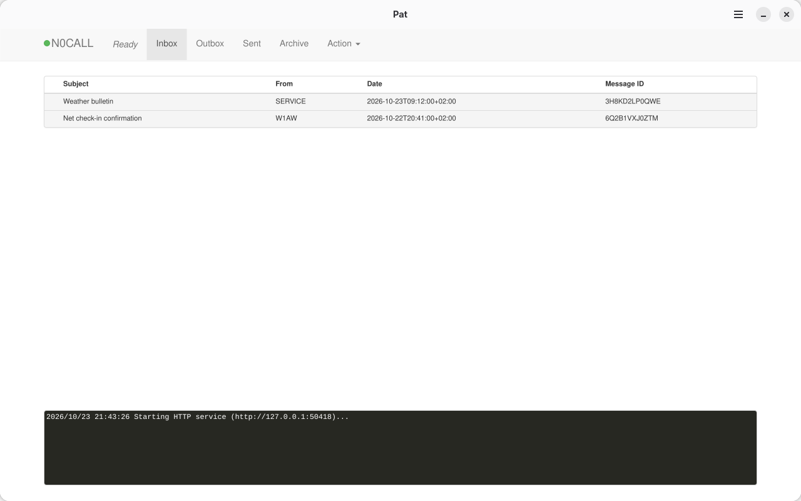

# Pat Desktop

**Pat, the Winlink client, as a regular desktop app.**

> [!IMPORTANT]
> Pat Desktop is an **unofficial**, community-maintained project. It is **not affiliated with, endorsed by or supported by** the [Pat project](https://getpat.io), its author Martin Hebnes Pedersen (LA5NTA), or the Winlink Development Team. Please report problems with Pat Desktop here, not upstream, unless you can reproduce them with the plain `pat` command.

[Pat](https://github.com/la5nta/pat) is an excellent cross-platform Winlink client. On Linux you normally install it with Go or a package, start it from a terminal (`pat http`) and use it from a browser at `http://localhost:8080`. Pat Desktop does that for you: it starts from your application menu, opens in its own window, and starts and stops Pat in the background.



## Features

- **A real desktop app.** Launcher icon, its own window, single instance, keyboard shortcuts, desktop notifications for new messages.
- **No ports, no terminal.** Pat runs as a managed child process on a private loopback port. Closing the window shuts Pat down cleanly, and asks first if a Winlink session is in progress.
- **Radio setup from the app.** Your first launch opens Pat's configuration page (callsign, locator, ARDOP, VARA, PACTOR, AX.25, Hamlib rig control, GPSd, …). It is always under *Menu → Pat Configuration* (<kbd>Ctrl</kbd>+<kbd>,</kbd>).
- **Forms, attachments and links behave like a desktop app.** Winlink forms open in their own windows, attachments are saved through the normal file dialog, and external links open in your browser.
- **Light and dark.** Follows your desktop's light/dark setting. In dark mode Pat's pages use GNOME's dark colours.
- **Troubleshooting built in.** *Menu → Show Log* gives a live view of Pat's output, and *Restart Pat* restarts it without restarting the app.
- **Pristine upstream Pat.** Pat is built unmodified from a pinned upstream release tag, the same code as the official binaries, and identifies itself to Winlink exactly as upstream Pat does.

## Installing

Download from the [releases page](https://code.alvaroedo.io/alvaroemtnez/pat-desktop/releases) (also on the [GitHub mirror](https://github.com/alvaroemtnez/pat-desktop/releases)). Each release has a Flatpak bundle, an AppImage, and a `SHA256SUMS` file:

```sh
sha256sum -c --ignore-missing SHA256SUMS
```

### Flatpak (recommended)

```sh
flatpak install --user Pat_Desktop-X.Y.Z-x86_64.flatpak
```

The GNOME runtime it needs is fetched from Flathub automatically. The Flatpak is recommended because:

- it includes everything it needs, the same tested libraries on every distribution;
- it runs sandboxed, with access to the network and serial devices but not your files;
- it works on any distribution with Flatpak, including immutable ones like Fedora Silverblue or SteamOS.

To update, install the newer bundle the same way. Your configuration and mailbox are kept.

### AppImage

The AppImage bundles Pat but **uses GTK 4, libadwaita and WebKitGTK from your system**. That keeps it small (about 7 MB), but it needs a fairly recent distribution, e.g. Ubuntu 24.04+, Debian 13+ or Fedora 40+, with these packages installed:

| Distribution | Command |
|---|---|
| Debian, Ubuntu | `sudo apt install python3-gi gir1.2-gtk-4.0 gir1.2-adw-1 gir1.2-webkit-6.0 gir1.2-soup-3.0` |
| Fedora | `sudo dnf install python3-gobject gtk4 libadwaita webkitgtk6.0 libsoup3` |
| Arch | `sudo pacman -S python-gobject gtk4 libadwaita webkitgtk-6.0 libsoup3` |

Then:

```sh
chmod +x Pat_Desktop-X.Y.Z-x86_64.AppImage
./Pat_Desktop-X.Y.Z-x86_64.AppImage
```

If something is missing, the AppImage tells you which packages to install. It is not sandboxed and uses the same files as a native Pat install (`~/.config/pat`, `~/.local/share/pat`), so you can switch between them. Just don't run both at the same time. To get a menu entry, use an AppImage integration tool such as Gear Lever or AppImageLauncher.

### Radio hardware and permissions

| What | Flatpak | AppImage |
|---|---|---|
| Telnet / CMS, ARDOP, VARA, rigctld, AGWPE/Direwolf, GPSd (all over TCP) | Works | Works |
| Serial and USB devices (PACTOR modems, KISS TNCs, CAT/PTT cables) | Works. Your user still needs access to the device, usually through the `dialout` group | Same |
| Linux kernel AX.25 (`ax25+linux` engine) | Opt in, so Pat can read `/etc/ax25/axports`: `flatpak override --user --filesystem=host-etc:ro io.getpat.desktopapp` | Works |

Pat talks to modems and rig control through separate programs: ARDOP, VARA (under Wine), Direwolf, Hamlib's `rigctld`. Install and run those on your system as usual. Pat reaches them over TCP.

### Moving an existing Pat setup into the Flatpak

The Flatpak keeps its own copy of Pat's files. To reuse your current configuration and mailbox, quit Pat Desktop and run:

```sh
mkdir -p ~/.var/app/io.getpat.desktopapp/config ~/.var/app/io.getpat.desktopapp/data
cp -r ~/.config/pat ~/.var/app/io.getpat.desktopapp/config/
cp -r ~/.local/share/pat ~/.var/app/io.getpat.desktopapp/data/
```

Pat's `http_addr` setting is ignored: Pat Desktop always listens on a private loopback address. If you want to reach Pat from other devices on your network, use plain `pat http` instead.

## How it works

```
┌──────────────── Flatpak sandbox / AppImage ─────────────────┐
│  Pat Desktop (Python, GTK 4, libadwaita)                    │
│   ├─ starts:  pat http --addr 127.0.0.1:<port>              │
│   ├─ WebKitGTK window showing Pat's own web UI              │
│   └─ stops it with SIGINT on quit                           │
│  bin/pat ← unmodified upstream Pat, pinned tag and commit   │
└─────────────────────────────────────────────────────────────┘
```

The wrapper does not change Pat or re-implement its UI. It handles what a browser tab can't do well: process lifecycle, windows for forms, downloads, notifications, external links, and hiding Pat's "download the new version" prompt, which doesn't apply when the app is updated as a whole. [docs/ARCHITECTURE.md](docs/ARCHITECTURE.md) explains why Pat is built in instead of being downloaded at runtime.

## Building

Both scripts write to `dist/`.

**Flatpak.** Needs `flatpak`, plus `flatpak-builder` or `org.flatpak.Builder` from Flathub:

```sh
tools/build-flatpak.sh
flatpak install --user dist/Pat_Desktop-*.flatpak
```

**AppImage.** Needs Go, gcc, make, git and curl. The glibc of the build machine becomes the minimum glibc of the AppImage, so use an older distribution for releases. This is how CI builds it:

```sh
podman run --rm -v "$PWD:/src:Z" -w /src docker.io/library/golang:1-bookworm \
    sh -c 'git config --global --add safe.directory /src && tools/build-appimage.sh'
```

### Hacking without packaging

The wrapper is plain Python. With the AppImage dependencies above and a `pat` binary installed:

```sh
PAT_DESKTOP_PAT_BINARY=$(command -v pat) PAT_DESKTOP_DEBUG=1 python3 -m pat_desktop
```

`PAT_DESKTOP_DEBUG=1` enables the WebKit inspector (right click → Inspect Element). Careful: this uses your real `~/.config/pat`.

### Updating Pat

```sh
tools/update-pat.py            # latest upstream release, or: tools/update-pat.py v1.2.3
```

This re-pins the upstream tag and commit in the Flatpak manifest, which both formats build from, and regenerates `build-aux/flatpak/pat-go-vendor.json`, the list of Go modules Pat needs (Flatpak builds run without network access). A weekly CI job does this automatically and opens a pull request.

### Project layout

| Path | Contents |
|---|---|
| `pat_desktop/` | The wrapper application |
| `data/` | Desktop entry, AppStream metainfo, icons, screenshots |
| `build-aux/flatpak/` | Flatpak manifest, the single source of the Pat pin, and generated Go module sources |
| `build-aux/appimage/` | AppImage entry point |
| `tools/` | Build scripts, Pat updater, changelog and version tools |
| `.forgejo/workflows/` | CI, weekly Pat update check, tagged releases |
| `docs/` | Architecture notes and the release guide |

## Releasing

See [docs/RELEASING.md](docs/RELEASING.md). Changes go under `[Unreleased]` in [CHANGELOG.md](CHANGELOG.md). `tools/bump-version.py X.Y.Z` turns that into a release, and pushing the `vX.Y.Z` tag publishes it with both builds.

## AI use disclosure

Most of this repository was written with an AI coding assistant (Anthropic's Claude, through Claude Code). That includes the wrapper application in `pat_desktop/`, the build and release tools in `tools/`, the CI workflows, the Flatpak manifest, the AppImage entry point, the desktop and metainfo files, and the documentation. The maintainer directs the work and reviews and tests every change before it is pushed. The icons come from the official Pat logo, and the screenshots are captures of the running app.

Pat itself is not part of this repository and contains none of this code. It is built from the untouched upstream source.

## License

Pat Desktop is free software, licensed under the [GNU General Public License v3.0 or later](LICENSE).

Bundled components keep their own licenses: Pat is MIT-licensed (© Martin Hebnes Pedersen, LA5NTA), its web UI includes MIT-licensed libraries, and libax25 is LGPL-2.1. The Pat name and logo belong to the Pat project and are used here only to identify the software being packaged.

## Acknowledgements

All the radio work is done by [Pat](https://github.com/la5nta/pat) and its contributors. If Pat is useful to you, consider supporting the upstream project.
